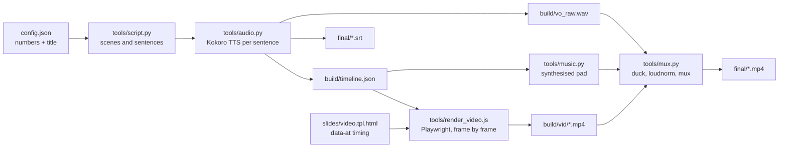

# narrated-slide-video-toolchain

Turn a sentence-by-sentence script and an HTML slide template into a narrated MP4 with captions, all built on your own machine.

## The problem

Narrated slide videos are slow to make by hand. You record a voiceover, cut it, line up each slide change with the words, write captions, and then do it all again when one sentence or one number changes. Screen-recording a slide deck gives you timing that drifts and numbers that stop matching the narration.

## How it works

The script is the source of truth. Each sentence is spoken by an open-source text-to-speech model, and the measured length of each clip becomes the timeline. Slide elements say which sentence they appear with, so changing the words moves the visuals with them.



1. **`tools/script.py`**: a list of scenes. Each scene has a lead-in, a tail, and sentences of `(spoken text, caption text, pause after)`. The caption can differ from the spoken text (for example "30" on screen, "thirty" spoken). Numbers come from `config.json` through `VARS`, so the narration and the slides use the same values.
2. **`tools/audio.py`**: speaks each sentence with [Kokoro](https://github.com/hexgrad/kokoro) (voice `af_heart`), caches clips by a hash of voice and text, trims silence, and measures each one. It writes the timeline, a voice track padded with exact-length silences, and an `.srt` file whose lines are spread across each sentence by character count. Each scene is rounded up to whole frames, and the rounding goes into its tail, so audio and video stay in sync.
3. **`tools/music.py`**: synthesises a quiet ambient chord pad with ffmpeg sine generators (no samples, so no licensing questions), cut to the video's length.
4. **`slides/video.tpl.html`**: one `<section>` per scene. Elements with class `in` fade in at `data-at`:
   - `"@1.2"`: 1.2 s into the scene
   - `"2"`: when sentence 2 starts (0-based)
   - `"2+0.5"` / `"2-0.2"`: an offset from that sentence
   - `data-d` sets the fade length, `data-out` fades the element out again, `data-var="key"` fills in a value from `VARS`, and `.grow` with `data-w` animates a bar width.
5. **`tools/render_video.js`**: opens the template in headless Chromium, calls `setScene(id)` then `setT(t)` for every frame, and pipes JPEG screenshots into ffmpeg (x264). Rendering does not depend on wall-clock time, so the same input gives the same frames every time.
6. **`tools/mux.py`**: lowers the music under the voice (sidechain compression), runs two-pass loudness normalisation to -16 LUFS / -1.5 dBTP, joins the scene clips and writes `final/<output_name>.mp4`.

The bundled script and slides are a short 3-scene demo ("How this toolchain works") with example numbers. Replace them with your own.

## Design rules

- **The script decides the timing.** Slides never carry hard-coded seconds tied to speech. They point at sentence numbers, so edits to the words move the visuals with them.
- **One source for numbers.** Any figure that is spoken or shown comes from `config.json`. You never have to edit the same number in two places.
- **A person reviews the output.** The toolchain makes a draft video. It does not publish, upload or send anything. Check the storyboard stills and the final cut before you share it.
- **Stop on errors.** Every ffmpeg call stops the build on failure. `tools/check.py` exits non-zero when the template and the script disagree. `mux.py` refuses to run on an estimated (silent) timeline.

## What it does NOT do

- It does not write the script or design the slides for you.
- It does not clone voices. It uses Kokoro's stock voices only.
- It has no editor UI, no transitions beyond fades and simple motion, and no media import beyond what you put in the HTML.
- It does not upload or host videos.
- Output is fixed at 1920×1080. Text uses the system font stack, so the look varies by OS.

## Setup

You need:

- **Python 3.10+** with `pip install -r requirements.txt` (Kokoro, soundfile, numpy). Kokoro downloads the `hexgrad/Kokoro-82M` model from Hugging Face the first time it runs. Kokoro needs **espeak-ng**: install it with your package manager (`brew install espeak-ng`, `apt install espeak-ng`).
- **Node.js 18+** with `npm install` (Playwright), then `npx playwright install chromium`.
- **ffmpeg** and **ffprobe** on your `PATH`.

You do not need any of these to run the tests or `tools/check.py`.

```sh
cp config.example.json config.json   # optional; the example config is used if config.json is missing

python3 tools/check.py                # template and script agree?
python3 tools/audio.py                # voice, timeline, captions
python3 tools/music.py                # music bed (optional; mux works without it)
node tools/render_video.js stills     # storyboard/<scene>.png, one per scene, to check layout
node tools/render_video.js video      # build/vid/<scene>.mp4 (slow: every frame is a screenshot)
python3 tools/mux.py                  # final/<output_name>.mp4
```

To preview layout without installing Kokoro, run `python3 tools/audio.py --estimate`. It guesses sentence lengths from word count and writes only the timeline, so `render_video.js stills` works.

Re-render one scene: `node tools/render_video.js video pipeline`.

## Config

`config.example.json`:

| Key | Meaning |
|---|---|
| `title` | Shown on the intro slide and written as the MP4 title |
| `output_name` | Base name for `final/<name>.mp4` and `.srt` |
| `voice` | Kokoro voice id (default `af_heart`) |
| `fps` | Frame rate |
| `example_seconds` | Example value used by the demo's numbers scene |

Environment variables:

- `TPL`: use a different template file
- `PWCHROME`: path to a Chromium binary, if you are not using Playwright's bundled one
- `ESPEAK_NG_LIB`, `ESPEAK_NG_DATA`: point Kokoro's phonemiser at a system espeak-ng. Some macOS installs need this when the bundled data cannot be found.

## Tests

```sh
python3 -m unittest discover -s tests -v
```

The tests use synthetic scenes and fake clip lengths. They cover timeline maths (frame rounding, audio length matching video length), caption splitting, SRT timestamps and the template checker. They need no TTS, browser or ffmpeg.

## Limitations

- Captions are spread across a sentence by character count, not aligned word by word, so they can run slightly ahead of or behind the voice.
- Video rendering screenshots every frame, so a few minutes of video takes a while.
- Kokoro is English-first here (`lang_code='a'`, American English).
- `--estimate` timings are rough. Use them only for layout.

## Status

Extracted from a toolchain used on a private project to produce narrated presentation videos. That project's script and slides are not included. The engine (TTS, timeline, music, render and mux) works the same way. For this copy it was split into testable functions, settings were moved to config, and `--estimate` and `tools/check.py` were added. The demo content here has been checked with the tests, the template check and a stills render. A full video has not been rendered from this copy.

## License

MIT. See [LICENSE](LICENSE).
